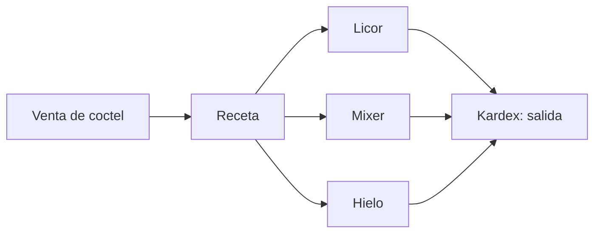

# Módulo · Catálogo

Gestiona todo lo que se vende: productos, presentaciones, precios y composición.

## Entidades

- `marca`, `categoria` (jerárquica), `unidad_medida`, `impuesto`
- `producto`, `producto_variante`, `codigo_barras`
- `lista_precio`, `precio_producto`, `receta`, `modificador`

## Reglas de negocio

1. Un **producto** es la definición base; lo que se vende es una **variante**
   (presentación), que concentra stock y precio.
2. Una variante puede tener **varios códigos de barras**.
3. El precio depende de la **lista** (detal, mayorista, happy hour) y la **moneda**.
4. Los productos preparados (cócteles, tobos) tienen **receta**: al venderse descuentan
   insumos del inventario.
5. Un producto con movimientos no se elimina físicamente: se marca `is_deleted`.
6. Cada producto define su **área destino** (`AreaDestino`: Barra/Cocina) para enrutar
   las comandas automáticamente; por defecto es Barra.

## Formulario coherente para Barra y Cocina

El alta/edición de productos adapta los campos según el área:

- **Barra:** muestra grado alcohólico (opcional) y código de barras por variante.
- **Cocina:** oculta grado alcohólico y código de barras (las comidas no los usan).
- **SKU opcional:** si se deja vacío se autogenera `{PRODUCTO}-{n}` (ej. `TACOS-1`).
- **Tipo sugerido:** en productos nuevos, Cocina sugiere `Preparado` y Barra `Simple`.

## Presentaciones, porciones y recetas

En un producto de Barra simple, cada variante es **una sola** de estas naturalezas (el catálogo
rechaza combinarlas):

| Naturaleza | Qué es | Existencia | Ejemplo |
| :--- | :--- | :--- | :--- |
| **Presentación** (`EsBase`) | Envase físico que se compra y se cuenta. Un producto puede tener varias. | Propia (`stock_producto`). | Botella 1 L, Botella 2 L, lata. |
| **Porción** | Se sirve abriendo una presentación **del mismo producto**; da un número entero de porciones por unidad. | Ninguna propia: sale de los envases abiertos. | Vaso (4 por la botella de 1 L, 8 por la de 2 L). |
| **Receta** | Consume fracciones de insumos (preparados y variantes heredadas). | Ninguna propia. | Cuba libre, o el «Vaso» heredado de 0,125 de una botella. |

Los orígenes de una porción se definen en el formulario del producto (selector **Naturaleza** de
cada variante) o con `GET/PUT /api/v1/variantes/{id}/origenes`. Reglas: presentación del mismo
producto, con existencia propia, porciones por unidad entero mayor que cero, sin recetas y sin
`EsBase`. No se puede eliminar ni dejar de ser presentación una botella que es origen de una
porción o tiene envases abiertos (409); tampoco convertir en presentación una porción que aún tiene
orígenes (422). Un preparado puede usar una porción como insumo (cantidad entera): la receta de un
cuba libre puede ser «1 trago de ron + 1 vaso de Coca-Cola».

El DTO de variante expone `naturaleza`, `porcionesDisponibles`, `porcionesPotenciales` y
`envasesCerradosAbribles` para que el POS y la carta del mesonero muestren qué se puede pedir.

### Migrar el caso Coca-Cola (recetas heredadas → presentación y porción)

Las recetas fraccionarias existentes **siguen funcionando** y se marcan como *Receta heredada*; no
hay conversión automática. Para pasar a control por botella destapada:

1. Edita el producto «Gaseosa Cola». Mantén «Botella 2 L» como **Presentación**.
2. Convierte «Litro» en una **Presentación** real de 1 L (con su propio SKU, costo y existencia
   inicial: se registra con una compra o un ajuste) y quita su receta.
3. Convierte «Vaso» en **Porción** y agrega dos orígenes: «Botella 1 L» = 4 y «Botella 2 L» = 8.
4. Guarda. Las ventas nuevas de vasos exigirán un envase abierto; barra lo destapa desde el panel
   **Envases abiertos** del KDS.

El stock que estaba contabilizado como fracción de la botella de 2 L no se mueve: ajusta la
existencia de las presentaciones con una toma física si hace falta.

## Flujo de venta con receta

## Endpoints

| Método | Ruta | Descripción |
| :--- | :--- | :--- |
| `GET` | `/api/v1/productos` | Lista con filtros y paginación. |
| `GET` | `/api/v1/productos/{id}` | Detalle con variantes. |
| `POST` | `/api/v1/productos` | Crea un producto. |
| `PUT` | `/api/v1/productos/{id}` | Actualiza. |
| `DELETE` | `/api/v1/productos/{id}` | Borrado lógico. |
| `GET` | `/api/v1/categorias` | Categorías jerárquicas. |
| `GET` | `/api/v1/marcas` | Marcas. |
| `GET` | `/api/v1/modificadores` | Modificadores/extras del catálogo. |
| `GET` | `/api/v1/productos/{id}/modificadores` | Modificadores asignados a un producto. |

## Interfaz

- **Web pública:** catálogo y menú con precios en USD/BS.
- **Sistema interno:** CRUD de productos, variantes, precios y recetas.
