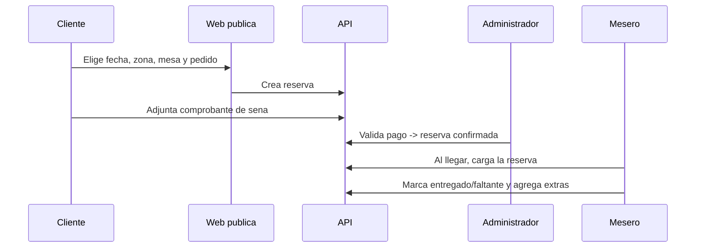

# Módulo · Club, Mesas y Reservas

Gestiona la distribución del local, las reservas y los eventos.

## Entidades

- `zona` (barra pública, mesas, juegos, pista, VIP)
- `plano`, `plano_elemento`
- `mesa`, `silla`
- `reserva`, `reserva_mesa`, `pedido_anticipado`, `reserva_pago`
- `evento`, `evento_media`, `lista_vip`, `entrada`

## Reglas de negocio

1. El **plano** representa zonas y elementos del local con posiciones.
2. Una **mesa** tiene capacidad (sillas), forma y posición.
3. Una reserva puede abarcar **varias mesas**.
4. La reserva puede incluir un **pedido anticipado**.
5. La **seña** se registra con comprobante y queda *pendiente de validación manual*.
6. Al llegar el cliente, el mesero carga la reserva y marca entregado/faltante.

## Croquis, duplicado y plantillas de plano

- **Croquis de fondo:** cada plano puede tener una imagen (PNG, JPG o WebP, máximo 5 MB) que se
  dibuja detrás de zonas y elementos en el editor y en la vista de operación del personal (no en
  la web pública). `FondoOpacidad` (0 a 1) y `FondoAjuste` (`contener`, `cubrir`, `estirar`) se
  guardan con el plano. La dirección de la imagen solo cambia por `POST/DELETE
  /api/v1/planos/{id}/fondo`; `PUT /api/v1/planos/{id}` la ignora. El servidor valida extensión,
  tipo declarado, tamaño y firma del archivo, y borra el archivo anterior al reemplazar, quitar o
  eliminar el plano. Los archivos se sirven como estáticos bajo `/uploads/planos/` con nombre GUID.
- **Duplicar:** `POST /api/v1/planos/{id}/duplicar` (`{ nombre?, comoPlantilla? }`) crea una copia
  **siempre inactiva**, con elementos de `Id` nuevo y su propia copia del archivo del croquis; no
  toca el plano activo. Entre planos normales conserva zona y mesa de cada elemento.
- **Plantillas:** un plano guardado con `comoPlantilla = true` no conserva vínculos a mesas (sí la
  zona), no puede activarse (`422`) y no aparece en `GET /api/v1/planos` salvo con `?plantillas=true`
  y el permiso `club:layout` (por id, sin el permiso, responde `404`). Duplicar una plantilla sin
  `comoPlantilla` crea un plano normal inactivo.

## Edición de la distribución

Crear, editar, duplicar y eliminar planos, zonas y mesas exige el permiso **`club:layout`**,
asignado solo al Administrador. `club:manage` se conserva para la lista VIP y las entradas, y
`desalojar` mesa sigue con `sales:write`. El resto de los roles consulta el plano en solo lectura.

> **Sesiones abiertas.** Los permisos viajan en el JWT: un Host con sesión iniciada conserva el
> acceso anterior hasta que expire su token (60 minutos) o vuelva a iniciar sesión.

## Flujo de reserva

## Estados de la reserva

`pendiente` → `confirmada` → `asistio` | `cancelada` | `no_asistio`.

## Endpoints

| Método | Ruta | Descripción |
| :--- | :--- | :--- |
| `GET` | `/api/v1/zonas` | Zonas del local. |
| `GET` | `/api/v1/mesas` | Mesas y disponibilidad. |
| `GET` | `/api/v1/planos/{id}` | Plano con elementos. |
| `POST` | `/api/v1/reservas` | Crea reserva (interna o pública). |
| `GET` | `/api/v1/reservas` | Lista/filtra reservas. |
| `POST` | `/api/v1/reservas/{id}/validar-pago` | Valida la seña. |
| `GET` | `/api/v1/eventos` | Eventos publicados. |
