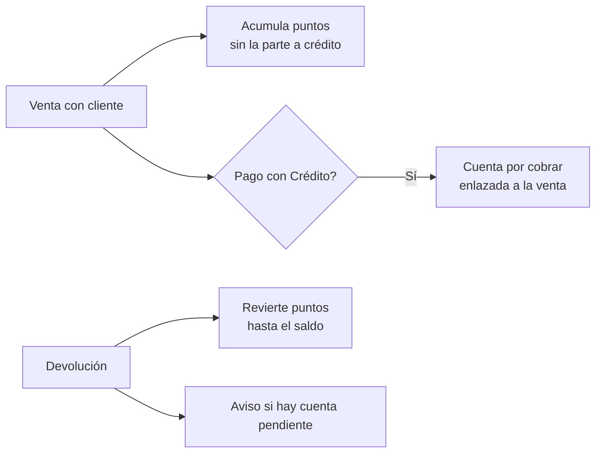

# Módulo · CRM y Clientes

Gestiona la relación con los clientes y la fidelización.

## Entidades

- `cliente` (datos personales y fiscales: RIF/CI)
- `puntos_movimiento` (fidelidad)
- `cuenta_por_cobrar`

## Reglas de negocio

1. Un cliente puede identificarse por RIF/CI; el consumidor final es anónimo (venta sin cliente).
2. **Cliente en la venta:** la venta del POS y el cierre de una cuenta de mesa aceptan un `clienteId`
   opcional. Un cliente inexistente o eliminado responde `404`; uno inactivo, `422`, y en ambos casos
   no se registra la venta.
3. **Puntos automáticos:** una venta con cliente suma ⌊USD pagado sin crédito × `Fidelidad:PuntosPorUSD`⌋
   puntos (1 por USD por defecto; `0` desactiva la acumulación) con un movimiento ligado a la venta,
   en la misma transacción. Una venta que falla (p. ej. por falta de stock) no deja puntos.
4. **Reversión por devolución:** devolver parte de una venta con cliente resta ⌊monto devuelto × tasa⌋
   puntos con un movimiento `Reversion`, limitado al saldo del cliente (nunca negativo): si ya canjeó
   puntos, la devolución se completa igual y se revierten solo los disponibles. El canje sigue siendo
   manual.
5. **Fiado (crédito):** pagar con el método `Crédito` exige un cliente activo (`422` si falta) y crea una
   `cuenta_por_cobrar` en USD (con la tasa de la venta), enlazada a la venta (`venta_id`, una por venta),
   en la misma transacción. Vence a los `Credito:DiasVencimiento` días (30 por defecto) o en la fecha
   indicada, que debe ser posterior a la venta. El crédito **no** genera puntos y **no** se acepta
   como abono de una cuenta de mesa (`422`): se otorga al cerrar la cuenta.
6. **Vencida:** una cuenta con saldo cuyo vencimiento ya pasó se muestra como `Vencida` (estado derivado
   al leer, sin tarea programada); una cuenta pagada nunca se muestra vencida.
7. **Devolución de una venta fiada:** la respuesta incluye un `aviso` indicando que la cuenta por cobrar
   se ajusta manualmente (el saldo no cambia solo).
8. El historial permite segmentar (frecuentes, VIP, inactivos).

Sin límite de crédito por cliente, intereses ni cobranza automática (fuera de alcance).

## Configuración

| Clave | Variable de entorno | Valor por defecto | Efecto |
| :--- | :--- | :--- | :--- |
| `Fidelidad:PuntosPorUSD` | `FIDELIDAD_PUNTOS_POR_USD` | `1` | Puntos por USD pagado sin crédito; `0` desactiva. |
| `Credito:DiasVencimiento` | `CREDITO_DIAS_VENCIMIENTO` | `30` | Plazo por defecto de la cuenta por cobrar. |

## Flujo de puntos y crédito

## Pantallas

- **Clientes** (Administrador y Cajero): lista y detalle con ventas, movimientos de puntos y cuentas por
  cobrar.
- **Cuentas por cobrar**: venta enlazada, estado `Vencida` y registro de pagos.
- **POS y cierre de cuenta:** buscador de clientes con creación rápida y condición de Crédito (cliente
  obligatorio, vencimiento visible).

## Endpoints

| Método | Ruta | Descripción |
| :--- | :--- | :--- |
| `GET` | `/api/v1/clientes` | Lista con búsqueda. |
| `POST` | `/api/v1/clientes` | Crea cliente. |
| `GET` | `/api/v1/clientes/{id}` | Detalle. |
| `GET` | `/api/v1/clientes/{id}/ventas` | Ventas del cliente (paginado, `crm:read`). |
| `GET` | `/api/v1/clientes/{id}/puntos` | Movimientos de puntos. |
| `GET` | `/api/v1/cuentas-por-cobrar` | Créditos pendientes (incluye vencidos). |
