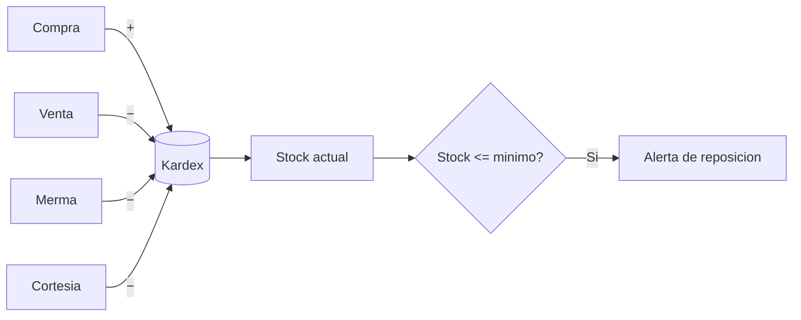
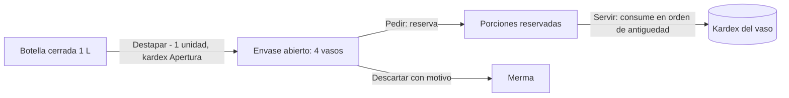

# Módulo · Inventario

Controla las existencias mediante un **kardex** de movimientos inmutables.

## Entidades

- `stock_producto` (existencia por variante)
- `tipo_movimiento` (compra, venta, ajuste, merma, cortesía, consumo interno)
- `movimiento_inventario` (kardex)
- `lote`, `ajuste_inventario`, `toma_fisica`
- `envase_abierto`, `porcion_origen`, `stock_porcion` (ver [porciones](#envases-abiertos-y-porciones))

## Reglas de negocio

1. El stock **no se sobrescribe**: cada cambio genera un `movimiento_inventario`.
2. La existencia actual (`stock_producto.cantidad`) es la suma del kardex.
3. Los movimientos son **inmutables**; un error se corrige con un movimiento inverso.
4. Toda salida por venta, merma o cortesía descuenta inventario.
5. Se alerta cuando `cantidad <= stock_minimo`.

## Tipos de movimiento

| Tipo | Signo | Origen |
| :--- | :---: | :--- |
| Compra | + | Recepción de orden de compra. |
| Venta | − | Cierre de venta / comanda entregada. |
| Ajuste | ± | Corrección manual autorizada. |
| Merma | − | Producto dañado/vencido (ver [merma](merma-cortesia.md)). |
| Cortesía | − | Reposición o invitación sin cobro. |
| Consumo interno | − | Consumo del personal. |
| Apertura | − | Se destapa una presentación (botella, lata) para servir porciones. |

## Flujo

## Envases abiertos y porciones

Los vasos y tragos no tienen existencia propia: salen de **envases abiertos** que la barra destapa a
mano.

- **Disponibilidad de una porción** = porciones restantes de los envases *abiertos* − reservadas.
- **Pedir** reserva las porciones en la misma transacción que crea la comanda. Si no hay envase
  abierto pero sí botellas cerradas, la respuesta es `422` con el código `porciones-sin-abrir`
  («Falta destapar una botella»); si no hay nada, `existencia-agotada`.
- **Servir** descuenta del envase abierto más antiguo (pasa al siguiente al agotarse) y registra una
  salida `Venta` sobre la porción. Lo servido **no se reintegra** al cancelar.
- **Destapar** lo decide el barman, que elige qué presentación abrir (1 L o 2 L). Requiere
  `inventory:open`. **Descartar** exige motivo, registra una merma por las porciones restantes y se
  rechaza con `409` si hay pedidos pendientes que dependen del envase.
- La venta directa del POS consume de inmediato y se rechaza con `422` si las porciones están
  comprometidas por mesas.
- Cada cambio se difunde por SignalR (`envase:actualizado`) para refrescar la carta del mesonero y
  los paneles de barra.

## Endpoints

| Método | Ruta | Descripción |
| :--- | :--- | :--- |
| `GET` | `/api/v1/stock` | Existencias con alertas. |
| `GET` | `/api/v1/movimientos-inventario` | Kardex filtrable. |
| `GET` | `/api/v1/envases-abiertos` | Envases abiertos (con `todos=true`, historial; filtros `porcionVarianteId`, `estado`, `limite`). |
| `POST` | `/api/v1/envases-abiertos` | Destapa una presentación: `{ porcionVarianteId, presentacionVarianteId }` (`inventory:open`). |
| `POST` | `/api/v1/envases-abiertos/{id}/descartar` | Descarta un envase con `{ motivo }` (`inventory:open`). |
| `GET` / `PUT` | `/api/v1/variantes/{id}/origenes` | Lee o reemplaza los orígenes de una porción (`catalog:write` para escribir). |
| `POST` | `/api/v1/ajustes-inventario` | Ajuste autorizado. |
| `POST` | `/api/v1/tomas-fisicas` | Conteo físico. |
