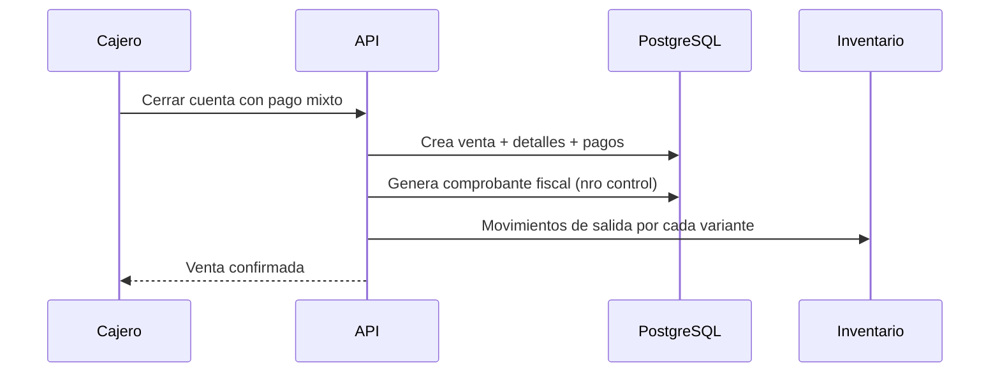

# Módulo · Ventas y POS

Registra las ventas y expone el punto de venta del cajero.

## Entidades

- `metodo_pago`
- `venta`, `detalle_venta`, `pago`
- `comprobante_fiscal`, `libro_venta`
- `devolucion`, `promocion`

## Reglas de negocio

1. Toda venta aplica la **tasa de cambio** vigente y guarda `total_usd` y `total_bs`.
2. Se admite **pago mixto**: varias filas en `pago` para una misma venta.
3. Al cerrar una cuenta se genera la `venta` y su `comprobante_fiscal`.
4. La devolución genera nota de crédito y reintegra inventario (según política).
5. Los descuentos requieren permiso y quedan auditados.
6. El **método de pago** lo elige el cajero (efectivo en la moneda seleccionada por defecto). Con
   `Crédito` la venta exige un cliente y genera una cuenta por cobrar; ver [CRM](./crm.md).
7. Una venta puede llevar un **cliente** opcional: suma puntos automáticamente y la respuesta incluye
   `puntosGanados` y `creditoUSD` (también en el ticket).
8. **Promociones:** cualquier rol que vende las consulta desde el POS (`sales:read`), pero crearlas,
   editarlas y eliminarlas exige `promotions:manage`, exclusivo del Administrador.

## Flujo de venta

## POS

- Vista de mesas y cuentas abiertas.
- Añadir ítems a una mesa.
- Registrar abonos y cobrar saldo.
- Atajos y búsqueda por código de barras.
- Selector de método de pago, buscador de clientes (con creación rápida) y vencimiento del crédito.

## Endpoints

| Método | Ruta | Descripción |
| :--- | :--- | :--- |
| `POST` | `/api/v1/ventas` | Registra una venta (con `clienteId` y `vencimientoCredito` opcionales). |
| `GET` | `/api/v1/ventas` | Lista con filtros por fecha/turno. |
| `GET` | `/api/v1/ventas/{id}` | Detalle. |
| `POST` | `/api/v1/ventas/{id}/pagos` | Registra pagos (mixto). |
| `POST` | `/api/v1/ventas/{id}/devoluciones` | Devolución / nota de crédito (revierte puntos y puede traer un `aviso`). |
| `GET` | `/api/v1/metodos-pago` | Métodos disponibles. |
