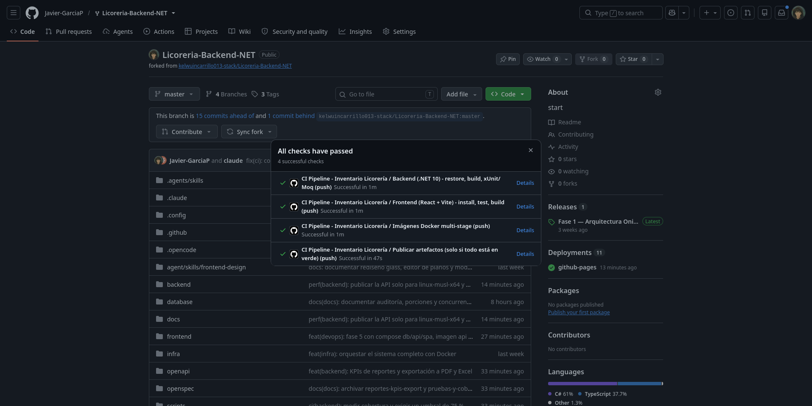
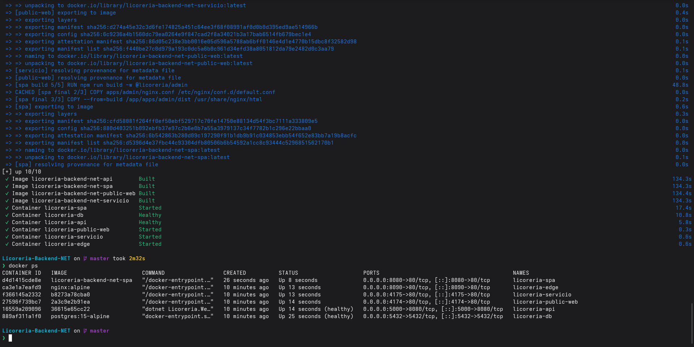

# Fase 5 · Contenerización, Docker Compose y CI/CD

## Orquestación (`docker-compose.yml`)

| Servicio | Imagen / build | Puerto host | Notas |
|---|---|---|---|
| `db` | `postgres:15-alpine` | 5432 | volumen `postgres_data`, healthcheck `pg_isready` |
| `api` | `backend/src/Licoreria.WebAPI/Dockerfile` (SDK 10.0 → `aspnet:10.0-alpine`) | 5000 | espera `db` (`service_healthy`), healthcheck `/health`, JWT y cadena de conexión por entorno |
| `spa` | `frontend/apps/admin/Dockerfile` (`node:22-alpine` → `nginx:alpine`) | 8080 | espera `api` saludable; `VITE_API_URL` se inyecta en build |

Se mantienen además `public-web`, `servicio`, `edge` y `pgadmin` (perfil `tools`).

```bash
docker compose up --build -d
docker ps          # db, api y spa deben aparecer (healthy)
```

SPA: <http://localhost:8080> · API/Swagger: <http://localhost:5000/swagger>

## CI (`.github/workflows/ci.yml`)

Se dispara en push y pull_request a `main`/`master`. Jobs: `backend-ci` (restore, build, xUnit + Moq),
`frontend-ci` (npm ci, test, build). Solo si ambos pasan se ejecutan `publish-artifacts`
(artefacto `api-publish`) y `docker-build` (construye las imágenes y lista su tamaño).
Los workflows `backend.yml` y `frontend.yml` siguen aportando cobertura, contrato OpenAPI e integración.

## Dominio: las 4 dimensiones

| Dimensión | Campos |
|---|---|
| Identificación comercial | `Producto.Nombre`, `Marca`, `Categoria`, `ProductoVariante.Sku`, `CodigoBarras.Codigo` (EAN-13) |
| Gestión financiera | `PrecioCompraUSD` (costo), `PrecioVentaUSD`, `Impuesto` |
| Control / umbrales de stock | `StockProducto.Cantidad`, `StockMinimo`, `StockMaximo` |
| Logística / almacén | `UnidadMedida` (Botella, Caja, Litro), `StockProducto.Ubicacion` (migración `UbicacionStock`) |

El diccionario completo está en `docs/dev/03-base-datos/diccionario-datos.md`.

## Pruebas

`backend/tests/Licoreria.UnitTests/ServicioCatalogoProductoTests.cs` valida con xUnit + Moq (patrón AAA)
la lógica del servicio de productos.

## Tamaño de imágenes

`spa` ≈ 106 MB en disco (< 120 MB). `api` ≈ 248 MB en disco descomprimido (base `aspnet:10.0-alpine` ≈ 204 MB
más 44 MB de la app, publicada solo para `linux-musl-x64`); su tamaño comprimido de transferencia es menor.
Reducirla más requiere recortar el runtime (trimming/ReadyToRun), pendiente.

## Evidencias




